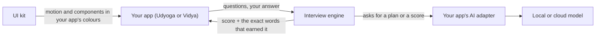

<div align="center">

<h1>Pariksha interview kit</h1>

<h4>One shared mock-interview engine and one shared look, used by the Brahma career apps.</h4>

<p>
  
  
  
  
</p>

<p>
  <a href="#whats-inside">What's inside</a> •
  <a href="#use-it-in-an-app">Use it in an app</a> •
  <a href="#how-it-works">How it works</a> •
  <a href="#privacy-rules-that-travel-with-the-engine">Privacy</a> •
  <a href="#for-developers">For developers</a>
</p>

</div>

*Pariksha* (परीक्षा) means "test" or "examination".

This repo holds two Flutter packages that Udyoga (job search) and Vidya (study companion) share.
Fix the interviewer once and both apps get the fix. Scores mean the same thing in both apps.

> [!NOTE]
> **Status: early (step J2).** `ui_kit` holds the shared motion and components, and Udyoga and
> Vidya use it. `interview_engine` now holds Udyoga's interviewer (voice, camera set-up cues,
> question plans, probes and verified-quote scoring); Udyoga uses it. Vidya's spoken interviewer
> comes next (J3).

## What's inside

| Package | What it is for | Native libraries |
| --- | --- | --- |
| [`interview_engine`](packages/interview_engine) | The mock interviewer: questions, follow-ups, scoring that must quote your own words, on-device voice and camera set-up cues | Yes: speech (sherpa_onnx), on-device vision (LiteRT), camera, microphone |
| [`ui_kit`](packages/ui_kit) | Shared motion and components: page rise, fade-ins, toasts, sheets, stat tiles, shimmer loading | None |

- 🎙️ **Speaks and listens on your device** – voice runs offline (Kokoro voice, Moonshine
  transcripts, Silero voice detection, all through sherpa_onnx).
- 🧠 **Bring your own AI** – the engine never picks a model. Each app plugs its own in through one
  small interface (`InterviewBrain`).
- 🗄️ **No database** – the engine keeps nothing. Each app stores results its own way.
- 🎨 **Each app keeps its colours** – the kit reads colours from a `KitPalette` theme extension.
  Udyoga stays azure; Vidya gets moss and clay.
- 🪶 **The look without the weight** – `ui_kit` has no speech libraries, so an app can take the
  look on its own.

## Use it in an app

Apps depend on a tagged release over git, the same way the Brahma apps depend on `brahma_core`.

**Step 1. Add the packages to the app's `pubspec.yaml`.** Pin each to a tag:

```yaml
dependencies:
  interview_engine:
    git:
      url: https://github.com/sudharamachandranrajeev/pariksha-interview-kit.git
      path: packages/interview_engine
      ref: v0.1.0
  ui_kit:
    git:
      url: https://github.com/sudharamachandranrajeev/pariksha-interview-kit.git
      path: packages/ui_kit
      ref: v0.1.0
```

**Step 2. Work against a local checkout (optional).** Create `pubspec_overrides.yaml` next to the
app's `pubspec.yaml`:

```yaml
dependency_overrides:
  interview_engine:
    path: ../pariksha-interview-kit/packages/interview_engine
  ui_kit:
    path: ../pariksha-interview-kit/packages/ui_kit
```

Add `pubspec_overrides.yaml` to the app's `.gitignore`. Never commit it: other people's builds
would look for your folders.

**Step 3. Install a palette.** Add a `KitPalette` to the app's theme, use the page rise, and
wrap the app in the shadcn bridge the kit's cards need:

```dart
MaterialApp(
  theme: ThemeData(
    extensions: const [KitPalette(primary: Color(0xFF2E6AFE), /* ... */)],
    pageTransitionsTheme: PageTransitionsTheme(builders: RisePageTransitionsBuilder.everywhere()),
  ),
  builder: (context, child) => KitShadBridge(child: child!),
);
```

See [`packages/ui_kit`](packages/ui_kit) for the list of components.

**Step 4. Plug in the AI.** Extend `PromptedInterviewBrain` and implement `ask`: send the
request's system prompt, text parts and JSON schema to the app's own AI and return the reply.
The engine writes the prompts, so scoring is the same in every app.

```dart
class MyBrain extends PromptedInterviewBrain {
  MyBrain(this.ai);
  final MyAi ai;

  @override
  Future<Map<String, Object?>> ask(BrainRequest r) =>
      ai.json(system: r.system, parts: r.texts, schema: r.schema, maxTokens: r.maxTokens);
}
```

Udyoga's adapter over its `Ai` providers is `lib/domain/interview_brain.dart` in Udyoga.

**Step 5. Use the shared model folder (desktop).** Point the model manager at
`sharedModelFolder()` when it is not null, after `adoptModels` has moved any models the app
downloaded before. See [`packages/interview_engine`](packages/interview_engine#where-the-models-live).

## How it works



- The app gives the engine questions and your answer. The engine asks the app's AI for scores.
- Every score must quote your answer. The engine checks the quote; no match means N/O (not observed).
- A strength must quote the line that earned it, and there is one fix. Scoring runs twice with the
  criteria in a different order; where the runs disagree it says "uncertain".
- "Improve my answer" waits for your own attempt and refuses a rewrite that adds a number, name or
  achievement you did not give.
- Likely questions are ranked by evidence (person specification, the organisation's own sources,
  past candidates, common questions); each says why.
- The twelve honesty rules and where each is enforced are listed in the
  [engine README](packages/interview_engine/README.md#the-honesty-rules-where-each-is-enforced).
- The engine has no database and does not import `brahma_core`.

## Privacy rules that travel with the engine

These rules ship with the package, so every app that uses it inherits them.

1. **No MediaPipe and no ML Kit.** On-device vision uses LiteRT only. A test
   (`test/privacy_test.dart`) fails if either appears anywhere in the dependency tree.
2. **Network-off test.** Importing and starting the engine must not contact another machine.
   `test/network_off_test.dart` traps every connection and checks that none was tried. Only this
   machine is allowed (for a local Ollama).
3. **Recordings are never synced.** Audio and video stay in app-private storage. They never go to a
   synced table, a backup or an AI. Only the transcript is sent to the AI.
4. **Video is opt-in.** Video takes are off unless you turn them on for a session, with a camera
   indicator while recording.
5. **Auto-delete.** Video takes delete themselves after **14 days** by default, and there is a
   delete-all button.
6. **No emotion, eye-contact or identity scoring.** Camera checks give set-up tips only.

> [!IMPORTANT]
> Rules 1–3 have tests in the package (`privacy_test.dart`, `network_off_test.dart`): no banned
> library or database import, no connection to another machine from any part of the engine, and
> recordings written only inside the take store's folder. Rules 4 and 5 (video takes) arrive in J7.

## Why `ui_kit` does not depend on brahma_core

Udyoga's kit files use two things from `brahma_core`:

- `Motion.reduced(context)` – one line:
  `MediaQuery.maybeDisableAnimationsOf(context) ?? false`. The kit has its own copy,
  `reducedMotion(context)`.
- `Status` – a five-value enum (good, warning, serious, critical, info) with fixed colours and
  icons. The kit has its own copy, `KitStatus`, with the same values, colours and icons. An app
  converts by name: `KitStatus.values.byName(status.name)`.

Copying these few lines keeps `brahma_core` out of the kit, so `brahma_core` needs no changes.

## For developers

<details>
<summary>Build, test and check the native libraries</summary>

You need Flutter 3.47.7 (stable). On Debian or Ubuntu, install the Linux build tools first:

```sh
sudo apt-get install clang cmake ninja-build pkg-config libgtk-3-dev liblzma-dev \
  libgstreamer1.0-dev libgstreamer-plugins-base1.0-dev gstreamer1.0-plugins-good
```

1. Test each package:

   ```sh
   cd packages/interview_engine && flutter pub get && flutter analyze && flutter test
   cd ../ui_kit && flutter pub get && flutter analyze && flutter test
   ```

2. Build the example app for Linux:

   ```sh
   cd example && flutter build linux --release
   ```

3. Check that the native libraries load. The app prints what loaded and exits:

   ```sh
   ./build/linux/x64/release/bundle/pariksha_example --probe
   # pariksha probe: sherpa_onnx=2.0.2 litert=2.21.0 cameras=1
   ```

CI (`.github/workflows/ci.yml`) runs format, analyze and tests for each package and the example,
then builds the example on Linux and checks the native libraries are bundled.

</details>

## Related

| App | What it does |
| --- | --- |
| Udyoga | Job search: openings, tailored CVs, applications and interview practice |
| Vidya | Study companion: courses, drills and mock interviews for each job |
| brahma_core | Shared core of the Brahma apps (not used by this kit) |

## License

[MIT](LICENSE)

> GitHub [@sudharamachandranrajeev](https://github.com/sudharamachandranrajeev)
